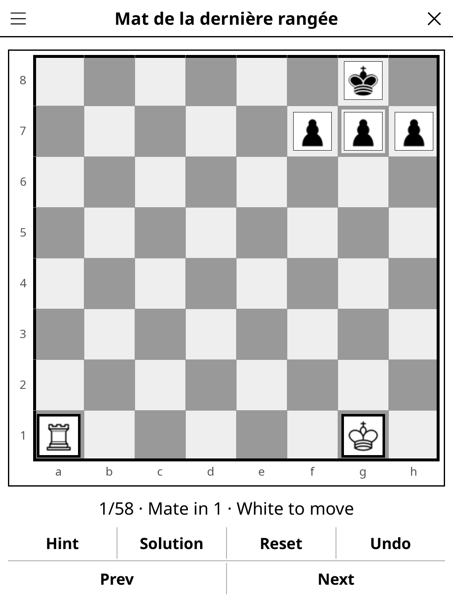

# chesscourse.koplugin

A Chess Lessons plugin for [KOReader](https://github.com/koreader/koreader).

## Screenshot

## Rules

Work through guided chess exercises. Each lesson presents a board position and an objective — make the correct moves to advance. Wrong moves are rejected. Progress through lessons to master chess fundamentals.

## Features

- **58 lessons** — mates in 1, 2 and 3, tactics (forks, pins, skewers, discovered attacks), endgames and openings
- **French and English** — lesson titles and hints follow KOReader's language (French UI → French, otherwise English)
- **Step-by-step guidance** — instructions for each exercise
- **Progress tracking** — completed lessons are remembered
- **Auto-save** — current lesson position saved on exit

## Installation

1. Download `chesscourse.koplugin.zip` from the [latest release](../../releases/latest).
2. Extract into the `plugins/` folder of your KOReader data directory.
3. Restart KOReader.
4. Open the menu → **Tools** → **Chess Lessons**.

## Controls

| Action | How |
|--------|-----|
| Select a piece | Tap it |
| Make a move | Tap the destination square |
| Show rules | Tap **Rules** |

## License

GPL-3.0 — see [LICENSE](LICENSE).
